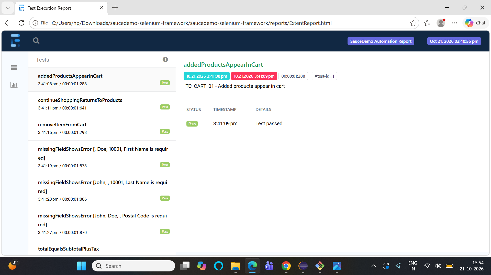

# SauceDemo Test Automation Framework

   

End-to-end UI automation framework for the e-commerce demo site [SauceDemo](https://www.saucedemo.com/),
built with **Java, Selenium WebDriver, TestNG and Maven** using the **Page Object Model**.
The repo also includes the manual testing artifacts (test plan, test cases, bug report format) so it shows
the complete QA workflow, not just scripts.
   

## Features
- Page Object Model with a reusable `BasePage` (explicit waits, no `Thread.sleep`)
- 21 automated test executions across Login, Inventory, Cart and Checkout modules
- Data-driven tests using TestNG `@DataProvider`
- Test groups: `smoke` and `regression`
- Thread-safe `WebDriver` management (`ThreadLocal`), ready for parallel runs
- Cross-browser support: Chrome (default), Firefox, Edge, plus headless mode
- Extent HTML report with automatic screenshot on failure
- Config-driven (`config.properties`) with command-line overrides
- CI pipeline with GitHub Actions (headless run, report uploaded as artifact)

## Tech stack
| Area | Tool |
|---|---|
| Language | Java 11+ |
| Automation | Selenium WebDriver 4 |
| Test runner | TestNG |
| Build | Maven |
| Reporting | ExtentReports |
| CI | GitHub Actions |

## Project structure
```
src/main/java/com/qa
  base/BasePage.java          common wait/click/type helpers
  pages/                      LoginPage, InventoryPage, CartPage, CheckoutPage
  utils/                      DriverFactory, ConfigReader, ScreenshotUtil, ExtentManager
src/main/resources/config.properties
src/test/java/com/qa
  base/BaseTest.java          setup / teardown
  listeners/TestListener.java report + screenshot on failure
  tests/                      LoginTest, InventoryTest, CartTest, CheckoutTest
docs/                         Test_Plan.md, Test_Cases.xlsx, Bug_Report_Template.md
testng.xml
.github/workflows/ci.yml
```

## How to run
Prerequisites: JDK 11+, Maven, and Chrome (or Firefox/Edge). No manual driver download is needed.

```bash
git remote add origin https://github.com/PiyushThakur01/saucedemo-automation-framework.git
cd saucedemo-automation-framework

mvn test                                 # all tests, Chrome
mvn test -Dgroups=smoke                  # smoke tests only
mvn test -Dbrowser=firefox               # another browser
mvn test -Dheadless=true                 # headless mode
```
After the run, open `reports/ExtentReport.html`. Failure screenshots are in `reports/screenshots/`.

## Test coverage
| Module | Scenarios |
|---|---|
| Login | valid login, locked-out user, 4 invalid-credential combinations, logout |
| Inventory | product count, sort by price (asc/desc), sort by name (Z-A), cart badge add/remove |
| Cart | items appear in cart, remove item, continue shopping |
| Checkout | end-to-end order, total = subtotal + tax, 3 mandatory-field validations |

## Manual testing artifacts (`docs/`)
- **Test_Plan.md**: scope, approach, environment, risks, entry/exit criteria
- **Test_Cases.xlsx**: manual test cases with steps, expected results and automation mapping
- **Bug_Report_Template.md**: defect format used for logging issues in Jira

## Author
Piyush Singh | piyushsingh7652.com | [LinkedIn](https://www.linkedin.com/in/piyush-singh-701639251/)
